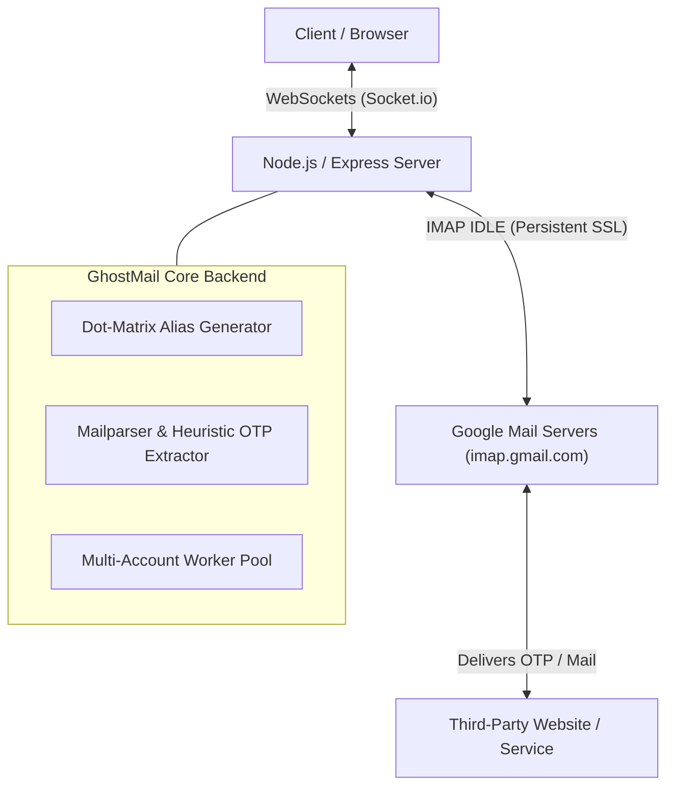

# 👻 GhostMail Core
> **High-Performance Disposable Gmail & OTP Stream Engine**  
> An open-source, self-hosted real-time temporary email platform powered by official Gmail/Googlemail domains, IMAP IDLE push sockets, and automatic OTP code extraction.

[](https://nodejs.org/)
[](https://socket.io/)
[](LICENSE)

---

## 💡 The Problem & The Solution

* **The Problem:** 95% of modern websites (SaaS, AI platforms, streaming trials, forums) immediately detect and block disposable email services like *TempMail* or *Mailinator* because they use well-known burner domains.
* **The Solution:** **GhostMail Core** uses real, official `@gmail.com` and `@googlemail.com` accounts connected via IMAP IDLE. Using dot-matrix mathematical permutations and alias routing, a single base account generates **over 16,000+ unique addresses** that deliver directly to your private, real-time web dashboard without exposing your real identity.

---

## ⚡ Key Features

* **🛡️ 100% Official Gmail Domains:** All generated addresses land under `@gmail.com` or `@googlemail.com`, completely bypassing anti-disposable filters.
* **⚡ Sub-Second Real-Time Push:** Listens to Google's mailboxes using the low-latency **IMAP IDLE** protocol and streams new emails to the browser in real time via **WebSockets (Socket.io)** — no manual refreshing required.
* **🔑 Smart OTP & Link Extractor:** Built-in heuristic Regex engine automatically scans email headers and bodies, extracting 4 to 8-digit verification codes and activation links with 1-click clipboard copy.
* **🔄 Multi-Account Pool:** Scale from 1 to 50+ base accounts seamlessly. GhostMail rotates accounts dynamically to prevent rate limits and ensure balanced load.
* **🎨 Modern Glassmorphism UI:** Titanium dark theme, audible notification chimes (Web Audio API), live stream status indicator, and instant address generation.
* **🔒 Privacy-First & Self-Hosted:** No external third-party servers tracking your verification codes. Your data stays 100% in your own server.

---

## 🏗️ Architecture



---

## 🚀 Quick Start (Local Setup)

### 1. Prerequisites
* **Node.js** v18+ and **npm** installed.
* At least **one Gmail account** with **2-Step Verification** enabled and an **App Password**.

### 2. Installation
```bash
# Clone the repository
git clone https://github.com/maykelcb/temp-gmail-hub.git
cd temp-gmail-hub

# Install dependencies
npm install
```

### 3. Configure `.env`
Create a `.env` file based on `.env.example`:
```env
PORT=3000

# JSON Array of accounts (supports 1, 5, 10 or more)
GMAIL_ACCOUNTS=[{"user":"your_email@gmail.com","pass":"your_16_character_app_password"}]
```

> **How to get a Google App Password:**
> 1. Go to [Google Account Security](https://myaccount.google.com/security).
> 2. Enable **2-Step Verification**.
> 3. Search for **"App Passwords"** (or visit [myaccount.google.com/apppasswords](https://myaccount.google.com/apppasswords)).
> 4. Create a new password named `GhostMail` and paste the 16-character code into your `.env`.

### 4. Run the Server
```bash
npm start
```
Open your browser and navigate to:
👉 **`http://localhost:3000`**

---

## 📡 REST API Reference

| Method | Endpoint | Description |
| :--- | :--- | :--- |
| `GET` | `/api/status` | Returns pool health, active accounts, combinations, and uptime. |
| `GET` | `/api/generate?mode=dots` | Generates a new random alias (`dots`, `googlemail`, or `plus`). |
| `GET` | `/api/messages` | Retrieves stored recent messages. |
| `DELETE` | `/api/messages` | Clears local memory inbox. |

---

## 📜 License
Distributed under the **MIT License**. Free for personal and community use.

Developed with passion by **Mayquel Bernaola**.
